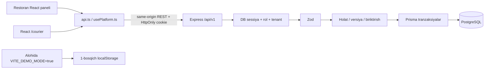

# FOOD / Tezkor Partner arxitekturasi

## 2-bosqichdagi holat

Mavjud React + TypeScript + Vite va CSS saqlandi. Alohida `server/` Node.js + TypeScript + Express modulli monolit qo‘shildi. Prisma PostgreSQL bilan ishlaydi. Haqiqiy bazaga ulanish ushbu kompyuterda mavjud emas; ishlash holati [VERIFICATION.md](VERIFICATION.md) da.

`server/src/app.ts` — test qilinadigan Express factory, `index.ts` — config, DB ulanishi va HTTP lifecycle. `domain.ts` biznes o‘tishlari, `security.ts` xeshlash/token, `validation.ts` Zod kontraktlari. `providers.ts` faqat kelajak adapterlari. `config.ts` muhitni ishga tushishda validatsiya qiladi. App global DB ulanishini yashirmaydi va baza mavjud bo‘lmasa ishga tushmaydi.

Frontend `usePlatform` backend yoki aniq yoqilgan lokal demo rejimini boshqaradi. Backend o‘zgarishlari server tasdiqlamaguncha UI’da qo‘llanmaydi. Xatolar ko‘rsatiladi, polling/refresh mavjud; 401 da holat tozalanadi. Lokal demo o‘z domen qoidalari va localStorage bilan saqlangan. Unga API xatosi sababli avtomatik o‘tilmaydi.

## Baza

`User`, `Restaurant`, `Employee`, `Category`, `Product`, `Order`, `OrderItem`, `Courier`, `Delivery`, `Review`, `Promotion`, `WorkingHours` va `Session`.

- Employee va Courier User bilan bittadan bog‘lanadi; har biri bitta restoranga tegishli. ADMIN platforma bo‘ylab ishlaydi.
- Har tenant so‘rovi autentifikatsiyadan olingan restaurantId bilan cheklanadi.
- Product→Category, OrderItem→Order/Product, Delivery→Order/Courier, Review→Order composite FK bilan bir restoranga bog‘langan.
- Pul integer UZS, vaqt UTC, UI Asia/Tashkent. OrderItem nom/narxi snapshot; menyu tahriri eski tarixni o‘zgartirmaydi.
- SQL CHECK narx, son, reyting, chegirma, hafta kuni va soat formatini himoya qiladi.
- Delivery orderId unique, faol courierId partial unique index. Status va assignment Serializable tranzaksiyada, version optimistic concurrency bilan; P2034 qayta sinab ko‘riladi.
- Seed alohida *_demo bazasiga, faqat ALLOW_DEMO_SEED=true va development/test muhitida. Demo user/restoran/order belgilari va demoKey qayta ishga tushirishda real ma’lumotni buzishdan saqlaydi.

## Ruxsat va sessiya

ADMIN restoran/hisob yaratadi. EMPLOYEE o‘z restoranini boshqaradi. COURIER faqat o‘z faol topshiriqlarini va shaxsiy ma’lumotlari yashirilgan bo‘sh READY takliflarini ko‘radi. Qabuldan keyin manzil ochiladi. Server body’dan rol yoki xodimning restoranini qabul qilmaydi.

Parollar scrypt + tasodifiy salt; sessiya tasodifiy 256-bit token, DB’da SHA-256 xesh. HttpOnly/SameSite/production Secure cookie, 8 soat expiry, login rotatsiya va logout revocation. Rol, active va tenant har so‘rovda qayta olinadi. Zod, Helmet, JSON hajm limiti, login rate limit, CSRF custom header + origin tekshiruvi va no-store javoblar bor. Sirlar frontendga uzatilmaydi.

## Buyurtma va yetkazish

Xodim NEW→PREPARING→READY; faqat biriktirilgan kuryer READY→DELIVERING→COMPLETED. Staff dispatch va delivered statusini taqlid qila olmaydi. Xodim NEW/PREPARING/READY bekor qilishi mumkin; delivery cancel va kuryerni bo‘shatish atomar. Kuryer o‘z restoranining bo‘sh READY buyurtmasini oladi yoki restoran uni oldindan biriktiradi. Band kuryerning yana buyurtma olishi bloklanadi.

Order va Delivery alohida enumlarga ega. GPS tasdiqlovi yo‘q, yakunlash autentifikatsiyalangan kuryerning qo‘lda tasdig‘i. Tashqi provayderlar ulanmagan.

## Deployment va keyingi ishlar

Vite dev/preview `/api` ni loopback Express’ga proxy qiladi. Production’da bitta HTTPS origin ostida statik frontend + reverse proxy kerak; APP_ORIGIN aynan tashqi origin bo‘ladi. PostgreSQL ichki tarmoqda; Compose lokal porti 127.0.0.1 ga bog‘langan. `.env` Git’dan chiqarilgan, `.env.example` faqat shablon.

Keyingi bosqichlar: public customer checkout; persistent audit/outbox; reassign tarixi; idempotency yozuvlari; to‘lov/refund/ledger; scheduler va haqiqiy promo narxlash; WebSocket/push; multi-instance rate limit store; provider webhook imzosi/replay himoyasi; GPS maxfiyligi; backup/restore va monitoring. Hozirgi grafiklar namunaviy, moliya buyurtma summalaridan hisoblanadi. Qo‘shimcha branch modeli va mobil Expo app yaratilmagan.

Hujjat manbalari: [Express security](https://expressjs.com/en/advanced/best-practice-security/), [Prisma 6 transaction isolation](https://www.prisma.io/docs/orm/v6/prisma-client/queries/transactions). Prisma CLI konfiguratsiyasidagi effect/deepmerge-ts audit xabarlari patched overrides bilan yopilgan; generator/typecheck qayta tekshirilgan. Prisma major yangilash alohida migratsiya ishidir.
